# DER de la base de datos

> Generado con `npm run der` a partir de `prisma/schema.prisma`. No lo edites a mano: cambiá el schema,
> corré `npx prisma generate` y volvé a generar este archivo.

Tablas, columnas y relaciones tal como Prisma las crea en MySQL. Incluye las tablas intermedias de las
relaciones muchos a muchos implícitas. En cada columna se indica el tipo SQL, si admite nulos y si tiene
valor por defecto.

```mermaid
erDiagram
  Plan {
    int idPlan PK "INT, NOT NULL, con valor por defecto"
    varchar nombre "VARCHAR(191), NOT NULL"
    varchar tipo "VARCHAR(191), NULL"
    varchar descripcion "VARCHAR(191), NULL"
    decimal precio "DECIMAL(65,30), NOT NULL"
    int duracionMeses "INT, NULL, con valor por defecto"
    boolean activo "BOOLEAN, NOT NULL, con valor por defecto"
    datetime createdAt "DATETIME(3), NOT NULL, con valor por defecto"
    datetime updatedAt "DATETIME(3), NOT NULL"
  }
  Persona {
    int idPersona PK "INT, NOT NULL, con valor por defecto"
    varchar dni UK "VARCHAR(191), NOT NULL"
    varchar nombre "VARCHAR(191), NOT NULL"
    varchar apellido "VARCHAR(191), NOT NULL"
    varchar telefono "VARCHAR(191), NOT NULL"
    datetime fechaNac "DATETIME(3), NOT NULL"
  }
  Profesor {
    int idPersona PK, FK "INT, NOT NULL"
    varchar cargo "VARCHAR(191), NOT NULL"
    datetime fechaBaja "DATETIME(3), NULL"
  }
  Administrador {
    int idPersona PK, FK "INT, NOT NULL"
  }
  Turno {
    int idTurno PK "INT, NOT NULL, con valor por defecto"
    varchar nombre "VARCHAR(191), NULL"
    enum diaSemana "ENUM(LUNES, MARTES, MIERCOLES, JUEVES, VIERNES, SABADO, DOMINGO), NOT NULL"
    varchar horaDesde "VARCHAR(5), NOT NULL"
    varchar horaHasta "VARCHAR(5), NOT NULL"
    boolean activo "BOOLEAN, NOT NULL, con valor por defecto"
  }
  Socio {
    int idPersona PK, FK "INT, NOT NULL"
    datetime fechaAlta "DATETIME(3), NOT NULL, con valor por defecto"
    datetime fechaBaja "DATETIME(3), NULL"
    int planId FK "INT, NOT NULL"
    int planProximoId FK "INT, NULL"
    datetime planProximoDesde "DATETIME(3), NULL"
  }
  Actividad {
    int id PK "INT, NOT NULL, con valor por defecto"
    varchar nombre "VARCHAR(191), NOT NULL"
    varchar descripcion "VARCHAR(191), NULL"
    int cupoMaximo "INT, NOT NULL"
    datetime creadaEn "DATETIME(3), NOT NULL, con valor por defecto"
  }
  Clase {
    int idClase PK "INT, NOT NULL, con valor por defecto"
    enum diaSemana "ENUM(LUNES, MARTES, MIERCOLES, JUEVES, VIERNES, SABADO, DOMINGO), NOT NULL"
    varchar horaDesde "VARCHAR(5), NOT NULL"
    varchar horaHasta "VARCHAR(5), NOT NULL"
    int cupo "INT, NOT NULL"
    int idActividad FK "INT, NOT NULL"
    int idProfesor FK "INT, NOT NULL"
  }
  Inscripcion {
    int idInscripcion PK "INT, NOT NULL, con valor por defecto"
    datetime fechaInscripcion "DATETIME(3), NOT NULL, con valor por defecto"
    date fechaClase "DATE, NOT NULL"
    enum estado "ENUM(CONFIRMADA, CANCELADA), NOT NULL, con valor por defecto"
    boolean asistio "BOOLEAN, NOT NULL, con valor por defecto"
    int idSocio FK "INT, NOT NULL"
    int idClase FK "INT, NOT NULL"
  }
  Usuario {
    int idUsuario PK "INT, NOT NULL, con valor por defecto"
    varchar email UK "VARCHAR(191), NOT NULL"
    varchar usuario "VARCHAR(191), NULL"
    varchar passwordHash "VARCHAR(191), NOT NULL"
    boolean debeCambiarPassword "BOOLEAN, NOT NULL, con valor por defecto"
    enum rol "ENUM(ADMINISTRADOR, PROFESOR, SOCIO), NOT NULL"
    boolean activo "BOOLEAN, NOT NULL, con valor por defecto"
    datetime createdAt "DATETIME(3), NOT NULL, con valor por defecto"
    datetime updatedAt "DATETIME(3), NOT NULL"
    int personaId FK, UK "INT, NOT NULL"
  }
  Cuota {
    int idCuota PK "INT, NOT NULL, con valor por defecto"
    datetime mesAnio "DATETIME(3), NOT NULL"
    datetime fechaPago "DATETIME(3), NOT NULL, con valor por defecto"
    decimal valor "DECIMAL(65,30), NOT NULL"
    int socioId FK "INT, NOT NULL"
  }
  _ActividadToPlan {
    int A PK, FK "INT, NOT NULL, Actividad.id"
    int B PK, FK "INT, NOT NULL, Plan.idPlan"
  }
  _ProfesorToTurno {
    int A PK, FK "INT, NOT NULL, Profesor.idPersona"
    int B PK, FK "INT, NOT NULL, Turno.idTurno"
  }
  Persona ||--o| Profesor : "idPersona"
  Persona ||--o| Administrador : "idPersona"
  Persona ||--o| Socio : "idPersona"
  Plan ||--o{ Socio : "planId"
  Plan |o--o{ Socio : "planProximoId"
  Actividad ||--o{ Clase : "idActividad"
  Profesor ||--o{ Clase : "idProfesor"
  Socio ||--o{ Inscripcion : "idSocio"
  Clase ||--o{ Inscripcion : "idClase"
  Persona ||--o| Usuario : "personaId"
  Socio ||--o{ Cuota : "socioId"
  Actividad ||--o{ _ActividadToPlan : "A"
  Plan ||--o{ _ActividadToPlan : "B"
  Profesor ||--o{ _ProfesorToTurno : "A"
  Turno ||--o{ _ProfesorToTurno : "B"
```

## Restricciones únicas compuestas

- `Inscripcion`: (`idSocio`, `idClase`, `fechaClase`)
- `Cuota`: (`socioId`, `mesAnio`)

## Enumeraciones

- `DiaSemana`: `LUNES`, `MARTES`, `MIERCOLES`, `JUEVES`, `VIERNES`, `SABADO`, `DOMINGO`
- `EstadoInscripcion`: `CONFIRMADA`, `CANCELADA`
- `Rol`: `ADMINISTRADOR`, `PROFESOR`, `SOCIO`
